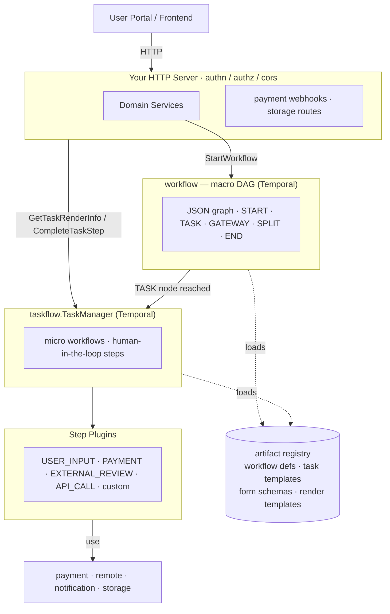

# OpenNSW Core

OpenNSW Core is an **open software library** — a set of Go modules you import to build a National Single Window / paperless-trade (or similar) application. Indicator 5–style install, test, contribute, and use paths are covered below.

This repository is the library itself (multiple Go modules), not a country deployment or a separate demo product. Applications you build with it live in their own repositories.

## What is a Single Window System?

A single window can give citizens or businesses one portal for end-to-end service applications (for example trade permits or licensing) instead of separate agency websites. Behind the scenes that often involves:

- Long-lived workflows that span days or weeks
- Interactive tasks where people submit forms, upload documents, or wait for review
- Payment gateways for fees
- Calls to external agency services
- UI driven by workflow state

Use the packages as a library in your own application; domain logic stays there.

## Packages

| Package                                    | Purpose                                                                                                                                                                                       |
|--------------------------------------------|-----------------------------------------------------------------------------------------------------------------------------------------------------------------------------------------------|
| [`artifact`](artifact/README.md)           | Versioned configuration registry — load workflow definitions, form schemas, and templates by ID (includes [`artifact/adapter`](artifact/adapter/README.md), bridge adapters for domain types) |
| [`authn`](authn/README.md)                 | JWT validation, identity context injection, and HTTP middleware                                                                                                                               |
| [`authz`](authz/README.md)                 | Scope-based authorization middleware and predicates, decoupled from authn                                                                                                                     |
| [`configyaml`](configyaml/README.md)       | Loads a YAML config file into a Go struct, resolving `{{env:NAME}}` / `{{file:/path}}` placeholders via `secret.SecretRef`                                                                    |
| [`cors`](cors/README.md)                   | CORS HTTP middleware                                                                                                                                                                          |
| [`database`](database/README.md)           | `database/sql` connection factory (PostgreSQL, MySQL, SQLite) with pooling and health checks                                                                                                  |
| [`htmlgen`](htmlgen/README.md)             | Print-ready HTML document generation from a static template and structured data, with contextual escaping                                                                                     |
| [`httputil`](httputil/README.md)           | Shared HTTP helpers: JSON request-body decode with a size limit, JSON responses, and correlation-ID-tagged API errors                                                                       |
| [`json`](json/README.md)                   | Packages for working with decoded JSON documents (includes [`json/jsonpointer`](json/jsonpointer/README.md), RFC 6901 JSON Pointer get/set)                                                   |
| [`notification`](notification/README.md)   | Multi-channel notification router (SMS, email) with pluggable providers                                                                                                                       |
| [`pagination`](pagination/README.md)       | Standard pagination envelope and query parameter parsing                                                                                                                                      |
| [`payment`](payment/README.md)             | Pluggable payment gateway orchestration with webhook processing and idempotency                                                                                                               |
| [`platform`](platform/README.md)           | Application-layer helpers often used with the other packages: authentication principal, catalog, audit and request logs, file storage routes and task authorization                           |
| [`remote`](remote/README.md)               | Registry-based outbound HTTP client with pluggable auth (API key, Bearer, OAuth2)                                                                                                             |
| [`replay`](replay/README.md)               | Data-driven end-to-end test engine: runs JSON flow files of HTTP steps against a running backend                                                                                              |
| [`secret`](secret/README.md)               | Secret-bearing config values (`SecretRef`) resolved from env, file, or literal sources                                                                                                        |
| [`shared`](shared/README.md)               | Small, dependency-free helpers (deep copy, nested map access, config validation) used across other modules                                                                                    |
| [`staticdata`](staticdata/README.md)       | Versioned JSON reference data served by ID from the artifact registry, with search, for portals and server-side lookups                                                                       |
| [`storage`](storage/README.md)             | File storage abstraction (local filesystem and AWS S3) with presigned URLs                                                                                                                    |
| [`taskflow`](taskflow/README.md)           | Micro-interactive task orchestration — the core engine for human-in-the-loop steps                                                                                                            |
| [`telemetry`](telemetry/README.md)         | OpenTelemetry setup: tracing, HTTP metrics and OTLP export, with the span trace ID as correlation ID (includes [`telemetry/logging`](telemetry/logging/handler.go))                           |
| [`temporal`](temporal/README.md)           | Temporal client factory                                                                                                                                                                       |
| [`trace`](trace/README.md)                 | HTTP request trace propagation and context-based trace ID correlation                                                                                                                         |
| [`uiprojector`](uiprojector/README.md)     | Zone-based, metadata-driven UI rendering from workflow state and business data                                                                                                                |
| [`workflow`](workflow/README.md)           | JSON DSL-driven Temporal workflow graph interpreter                                                                                                                                           |
| [`xmlgen`](xmlgen/README.md)               | XML document generation from a static template and structured data, with automatic escaping                                                                                                   |

## Requirements

| Need | Detail |
| --- | --- |
| Go | Each module declares its version in its `go.mod`. The root module requires **Go 1.26.0** (`go 1.26.0` in `./go.mod`). Some nested modules require a newer patch (for example `platform` declares `go 1.26.4`). |
| Temporal | Required at **runtime** only when your app runs `workflow` / `taskflow` workers. Local default from [`temporal`](temporal/README.md): `temporal server start-dev` → `localhost:7233`, namespace `default`. |
| SQL database | Required at **runtime** when your app uses [`database`](database/README.md) or SQL-backed stores. Drivers: PostgreSQL, MySQL, or SQLite (SQLite is enough for many unit tests). |
| Nothing else from this repo | No product Compose file is shipped here. Nested tools for contributors are listed in [CONTRIBUTING.md](CONTRIBUTING.md). |

## Installation

This repository is **multiple Go modules**. `go get github.com/OpenNSW/core` installs the **root** module only (`artifact`, `taskflow`, `workflow`). Other packages use their own paths and tags.

```sh
# Root module (pin main or a commit)
go get github.com/OpenNSW/core@main

# Examples of nested modules (pin a tag)
go get github.com/OpenNSW/core/httputil@v0.2.0
go get github.com/OpenNSW/core/database@v0.3.0
go get github.com/OpenNSW/core/temporal@v0.1.0
```

How to assemble an application, which systems to run locally, and how downstream apps upgrade dependencies: **[docs/using.md](docs/using.md)** and **[docs/releases.md](docs/releases.md)**.

## Documentation map

| Topic | Where |
| --- | --- |
| Install modules into an app; external systems; behaviour you can rely on | [docs/using.md](docs/using.md) |
| Architecture (macro / micro workflow) | [Architecture Overview](#architecture-overview) below |
| Technology stack and tool versions | [Technology stack](#technology-stack) below |
| Fork, test, pull request, keep a fork current | [docs/contributing/development.md](docs/contributing/development.md), [CONTRIBUTING.md](CONTRIBUTING.md) |
| Module tags and upgrading dependencies | [docs/releases.md](docs/releases.md) |
| Security reporting | [SECURITY.md](SECURITY.md) |
| Package APIs | Each package's `README.md` (links in the table above) |

## What callers can rely on

These packages are meant to help you:

1. **Orchestrate long-running service applications** as Temporal workflows defined by a JSON graph (`workflow`), including task activation and completion callbacks.
2. **Run human-in-the-loop steps** as short Temporal workflows with pluggable step plugins and UI projection (`taskflow`, `uiprojector`).
3. **Load versioned workflow/form/template artifacts** by ID from a configured loader (`artifact`).
4. **Authenticate and authorize HTTP callers** via JWT/JWKS and scope checks (`authn`, `authz`) without embedding product policy.
5. **Talk to SQL databases, object storage, payment gateways, notifiers, and remote HTTP APIs** through typed factories and interfaces (`database`, `storage`, `payment`, `notification`, `remote`).
6. **Expose consistent HTTP JSON errors and optional strict JSON body decoding** (`httputil`).

Exact APIs, config keys, and error types are defined in each package README and its tests—not by a separate requirements specification document.

## Technology stack

Versions below are taken from this tree (`go.mod` files, `Makefile`, `.github/workflows/ci.yml`). Nested modules may pin slightly different dependency versions; open the module's `go.mod` when you import that module.

| Component | Version in tree | Source |
| --- | --- | --- |
| Go (root module) | 1.26.0 | `./go.mod` |
| Go (`platform` module) | 1.26.4 | `platform/go.mod` |
| golangci-lint (local + CI) | v2.15.0 | `Makefile` `GOLANGCI_VERSION`, CI `golangci-lint-action` |
| Temporal Go SDK (root) | v1.51.0 | `./go.mod` `go.temporal.io/sdk` |
| Temporal Go SDK (`temporal` module) | v1.50.0 | `temporal/go.mod` |
| AWS SDK v2 (S3-related) | v1.48.0 | `./go.mod`, `storage/go.mod` |
| GORM (root) | v1.31.2 | `./go.mod` |
| CI Go install | `go-version-file` → each job's `go.mod` | `.github/workflows/ci.yml` |
| License | Apache-2.0 | `LICENSE`, SPDX headers |

Language and protocols used across packages include JSON, YAML, HTTP, JWT/JWKS, and OpenTelemetry (see [`telemetry`](telemetry/README.md)).

## Architecture Overview



A common pattern is a two-tier workflow:

1. **Macro workflow** (the `workflow` package) — a long-lived Temporal workflow for a full service application (for example an export permit). It moves through TASK, GATEWAY, and SPLIT nodes from a JSON graph.
2. **Micro workflow** (the `taskflow` package) — each TASK node can spawn a short-lived Temporal workflow for one interactive step (a form, a payment, a review). When that step finishes, the micro workflow signals the macro workflow to continue.

---

## Full Wiring Example

The following shows how to assemble the components into a working application in **your** codebase (illustrative wiring only — this repo does not ship a runnable product binary):

```go
func Build(ctx context.Context, cfg *Config) (*App, error) {
    // 1. Database — wrap the *sql.DB with GORM for the GORM-backed stores
    sqlDB, err := database.New(ctx, cfg.Database)
    if err != nil {
        return nil, err
    }
    db, err := gorm.Open(postgres.New(postgres.Config{Conn: sqlDB}), &gorm.Config{})
    if err != nil {
        return nil, err
    }

    // 2. Artifacts — one loader is the single source of truth. LoadSet reads
    //    configs/manifest_v1.json, manifest_v2.json, … (or configs/manifest.json)
    artifactLoader, _ := local.New(local.Config{Root: "configs"})
    artifacts, _ := artifact.LoadSet(ctx, artifactLoader)

    // 3. Payment
    paymentRepo := NewPaymentRepo(db)
    paymentRegistry, _ := payment.NewRegistry(cfg.Payment, map[string]payment.Factory{
        "govpay": govpay.NewGovPayGateway,
    })
    paymentService := payment.NewService(paymentRepo, paymentRegistry)

    // 4. Temporal client
    temporalClient, _ := temporal.NewClient(cfg.Temporal)

    // 5. Task subsystem
    taskStore := gormstore.New(db)
    pluginRegistry := plugins.NewRegistry()
    pluginRegistry.Register("USER_INPUT",      plugins.NewUserInputPlugin())
    pluginRegistry.Register("PAYMENT",         NewPaymentPlugin(paymentService))
    pluginRegistry.Register("EXTERNAL_REVIEW", NewExternalReviewPlugin(remoteManager))
    pluginRegistry.Register("MY_PLUGIN",       &MyPlugin{})

    assembler, _ := uiprojector.NewAssembler(templateProvider, uiprojector.DefaultProjectors())
    taskRenderer := zoneview.NewTaskRenderer(assembler)

    var tm *orchestrator.TaskManager
    microRunner := workflow.NewTemporalManager(
        temporalClient, cfg.Temporal.Namespace, "MICRO_WORKFLOW_QUEUE",
        func(ctx context.Context, p workflow.TaskPayload) (map[string]any, error) { return tm.StartTaskStep(ctx, p) },
        func(ctx context.Context, c workflow.WorkflowCompletion) error { return tm.HandleTaskCompletion(ctx, c) },
    )
    onTaskCompleted := func(parentWorkflowID, parentStepID string, vars map[string]any) error {
        return consignmentService.HandleTaskCompletion(ctx, parentWorkflowID, parentStepID, vars)
    }
    // Each task resolves its templates through the manifest version its workflow carries.
    tm = orchestrator.NewTaskManager(taskStore, artifacts, pluginRegistry, nil /* extensions */, microRunner, onTaskCompleted, taskRenderer)
    microRunner.StartWorker()

    // 6. Macro workflow runner
    macroRunner := workflow.NewTemporalManager(
        temporalClient, cfg.Temporal.Namespace, "INTERPRETER_TASK_QUEUE",
        onMacroTaskActivation, onMacroCompletion,
    )
    macroRunner.StartWorker()
    // Start each top-level workflow on the current manifest; the engine carries the version to
    // every child workflow and task:
    //   vars[workflow.VarManifestVersion] = artifacts.Current()
    //   macroRunner.StartWorkflow(ctx, id, def, vars)

    // 7. Auth
    authnManager, _ := authn.NewManager(userProfileSvc, cfg.Authn)
    authzr, _ := authz.New(func(ctx context.Context) (authz.Principal, bool) {
        ac := authn.GetAuthContext(ctx)
        return ac, ac != nil
    })

    // 8. HTTP
    mux := http.NewServeMux()
    withAuth := authnManager.RequireAuthMiddleware()
    mux.Handle("GET /api/v1/tasks/{id}",  withAuth(authzr.RequireScope("tasks:read")(getTaskHandler(tm))))
    mux.Handle("POST /api/v1/tasks/{id}", withAuth(authzr.RequireScope("tasks:write")(submitTaskHandler(tm))))
    mux.Handle("POST /api/v1/payments/{gatewayId}/webhook", webhookHandler(paymentService))

    return &App{Handler: cors.CORS(cfg.CORS)(mux)}, nil
}
```

## Contributing

Contributions are welcome. See [CONTRIBUTING.md](CONTRIBUTING.md) for local setup,
hooks, the Apache-2.0 license-header policy, and commit conventions, and
[docs/contributing/development.md](docs/contributing/development.md) for fork,
test, and pull-request steps.

After cloning, install tools and enable git hooks in one step:

```sh
make setup
```

Then run the root-module tests:

```sh
make test
```

## License

See [LICENSE](LICENSE).
